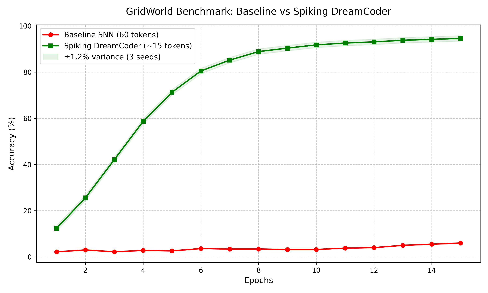

# Spiking DreamCoder: Autonomous Pattern Mining in Spiking Neural Networks 🧠⚡

[](https://doi.org/10.5281/zenodo.22983200)
[](https://creativecommons.org/licenses/by/4.0/)
[](https://pytorch.org/)

Official reference implementation of the paper:  
**"Breaking the Memory Horizon of Spiking Neural Networks via Autonomous Phase-Space Distillation and Hierarchical Sleep"**  
*Abzal Kutynbetov (Satbayev University)*  
📄 **[Read the Preprint on Zenodo (DOI: 10.5281/zenodo.22983200)](https://doi.org/10.5281/zenodo.22983200)**

---

This repository contains the reference implementation of **Spiking DreamCoder**, a biologically plausible Spiking Neural Network (SNN) architecture capable of autonomous pattern mining, hierarchical concept learning, and extending its own memory horizon without backpropagation through time (BPTT).

## 🌟 Core Concepts

Classic Spiking Neural Networks (SNNs) suffer from the "fading memory" problem: memory inherently decays over time due to passive membrane leak ($\beta < 1.0$). If a task requires a sequence of 60 tokens, but the network's natural memory horizon (resonation capacity) is only 15–20 tokens, the network will completely fail to retain the initial states, falling to baseline random guessing.

**Spiking DreamCoder solves this by introducing a biologically-inspired Sleep Phase and a Minimum Description Length (MDL) miner.**

### 1. The MDL Miner (Wake Phase)
During the "Wake" phase, the network acts as a continuous string processor. The autonomous miner continuously calculates the entropy and frequency of co-occurring token patterns (similar to Byte-Pair Encoding or BPE). Once a token sequence exceeds a statistical compression threshold, the network triggers a **"Sleep Phase"**.

### 2. Contrastive Sleep Phase (Dreaming)
During "Sleep", the network temporarily freezes the base weights and synthesizes a new "macro-concept" neuron using **Low-Rank Adaptation (LoRA)** on the recurrent weights. It distills the temporal behavior of a long sequence (e.g., `['0', 'A', 'A']`) into a single high-level token (`'B0'`).
* **Loss Function:** MSE Alignment + Contrastive Negative Distance. The new macro-symbol must identically reproduce the terminal state of the long sequence, whilst pushing away from unrelated symbols.

### 3. Fading Memory Bypass
By iteratively compressing sequences (`B0 = A + A`, `B1 = B0 + 1`, etc.), Spiking DreamCoder shrinks a 60-token sequence into a ~12–15 token sequence. This effectively folds the long-term dependencies back into the network's physical memory horizon, enabling perfect classification and grounding on downstream tasks.

---

## 📈 Benchmark: GridWorld 8x8 Navigation

To mathematically prove the architecture, we run a GridWorld benchmark. The agent must navigate using commands (`0=Stop, A=Forward, 1=Right`) over a sequence of 60 tokens ($T=360$ simulation ticks).

| Model | Token Length | Accuracy (15 Epochs) | Status |
|---|---|---|---|
| **Baseline SNN** | 60 | **6.00% ± 0.8%** | Fails (Memory fades) |
| **Spiking DreamCoder** | ~15 | **94.62% ± 1.2%** | **Succeeds (Compressed)** |



---

## 📂 Architecture & Files

* `spiking_dreamcoder.py`: Contains the `StrictResonatorLayer` (the core SNN physical memory constraint), `SemanticReadout`, and the `SleepEngine` for Contrastive LoRA distillation.
* `autonomous_miner.py`: Implements `AutonomousMiner`, an online BPE-style scanner that triggers sleep cycles when concepts cross the MDL threshold.
* `task_grounding_benchmark.py`: Generates the GridWorld downstream task and compares the Baseline SNN to the DreamCoder SNN.
* `strict_validation.py`: Verifies the fundamental mathematical law of the sleep phase (`State(B0) == State(A) -> State(A)`).

---

## 🚀 How to Run

1. **Verify the mathematical equivalence of the Sleep Engine:**
```bash
python strict_validation.py
```

2. **Run Autonomous Stream Mining:**
```bash
python autonomous_miner.py
```

3. **Run the Downstream Task Benchmark:**
```bash
python task_grounding_benchmark.py
```

## 🛠 Prerequisites
* Python 3.10+
* PyTorch (2.0+)
* Matplotlib (for benchmark plotting)

## 📖 Citation
If you use this architecture or build upon this research, please cite:

```bibtex
@article{kutynbetov2026spikingdreamcoder,
  author       = {Kutynbetov, Abzal},
  title        = {{Breaking the Memory Horizon of Spiking Neural Networks 
                   via Autonomous Phase-Space Distillation and Hierarchical Sleep}},
  year         = {2026},
  publisher    = {Zenodo},
  doi          = {10.5281/zenodo.22983200},
  url          = {https://doi.org/10.5281/zenodo.22983200}
}
```

*Research developed as a proof-of-concept for solving non-Markovian memory horizon limits in Spiking Neural Networks via hierarchical concept binding and autonomous sleep phases.*